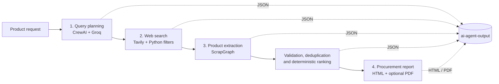

# ResearchFlow AI

### Multi-agent product research and procurement reports

ResearchFlow AI turns a product idea into a structured, evidence-based buying
shortlist. It generates targeted search queries, finds candidate product pages,
extracts product data, checks and ranks the results, and produces a shareable
procurement report.

The workflow is designed to use language models where they add value and
deterministic Python where consistency matters.

> **Current focus:** product research for the Egyptian e-commerce market, with
> search hints for Jumia Egypt, Noon Egypt, and Amazon Egypt.

---

## What it does

- **Plans product searches:** uses CrewAI and Groq to generate up to 10 varied,
  purchase-oriented search queries.
- **Finds product pages:** searches with Tavily, scores results, filters likely
  listings and irrelevant domains, and removes duplicate URLs.
- **Extracts comparable data:** uses ScrapGraph to inspect up to 10 product
  pages, including JavaScript-rendered pages, for titles, prices, discounts,
  images, and key specifications.
- **Improves data quality:** rejects incomplete or implausibly priced records,
  merges near-duplicate product titles, then ranks the remaining products.
- **Creates a procurement report:** generates a responsive HTML report with a
  comparison table, recommendation cards, and price/specification charts. PDF
  export is attempted when a working Playwright Chromium installation is
  available.
- **Keeps intermediate results:** saves JSON at each stage so the research
  process is inspectable and easier to troubleshoot.

## Workflow



## Architecture

| Stage | Component | Responsibility |
| --- | --- | --- |
| 1. Query planning | CrewAI + Groq (`llama-3.1-8b-instant`) | Produces diverse, specific search queries for the requested product. |
| 2. Search | Tavily + Python | Searches each query, adjusts relevance scores with product/price signals, filters results, and deduplicates URLs. No LLM call is used for this mechanical stage. |
| 3. Extraction | ScrapGraph | Extracts structured product fields from selected pages. JavaScript rendering is enabled, and Egypt is specified as the fetch country. |
| Data quality | Python + Pydantic | Validates records, removes near-duplicate titles, scores product specifications and price, and assigns recommendation tags. |
| 4. Reporting | Python + LiteLLM/Groq | Uses a small LLM response for report text; Python builds the HTML and injects product data and chart values. PDF generation is best-effort. |

### Ranking

Each valid product receives a specification score and a normalized price score:

```text
specification_score = min(number_of_specs / 5 + image_bonus, 1.0)
image_bonus         = 0.15 when a product image is available, otherwise 0
total_score         = 0.60 * specification_score - 0.40 * normalized_price
```

Products without a detected price receive a neutral normalized price score of
`0.5`; they are not treated as the cheapest. The report can identify **Best
Value**, **Best Budget**, and **Best Premium** options. The price and
specification scores are comparison aids, not a guarantee of product quality or
the lowest live market price.

## Quick start

### Requirements

- Python 3.10 or newer (Python 3.12 is a good choice).
- API credentials for Groq, AgentOps, Tavily, and ScrapGraph.
- Internet access for API calls and product-page retrieval.

Each provider may have its own usage limits or charges. Check the provider
terms and pricing before running larger searches.

### 1. Get the project and install dependencies

From PowerShell:

```powershell
git clone https://github.com/<YOUR_USERNAME>/<YOUR_REPOSITORY>.git
cd <YOUR_REPOSITORY>

py -m venv .venv
.\.venv\Scripts\Activate.ps1
python -m pip install --upgrade pip
pip install -r requirements.txt
```

If PowerShell does not allow virtual-environment activation, either enable
scripts for the current terminal with
`Set-ExecutionPolicy -Scope Process -ExecutionPolicy Bypass`, or run the
environment's Python directly as `.venv\Scripts\python.exe`.

### 2. Configure API keys

Create a local `.env` file from the example:

```powershell
Copy-Item .env.example .env
```

Set these four required values in `.env`:

```dotenv
GROQ_API_KEY=your_groq_api_key
AGENTOPS_API_KEY=your_agentops_api_key
TAVILY_API_KEY=your_tavily_api_key
SCRAPEGRAPH_API_KEY=your_scrapegraph_api_key
```

Keep real credentials private. `.env` is ignored by Git; do not commit API keys
or paste them into issues, logs, or screenshots.

### 3. Run a product search

Pass a product request as an argument:

```powershell
python .\agent_1_search_queries.py "gaming laptop"
```

Or run without an argument to enter a product interactively. If you leave the
interactive prompt blank, the application uses `coffee machine for the office`.

The current search instructions target the Egyptian market and use English
search queries. Search limits and filters are defined in the `Config` class in
`agent_1_search_queries.py`.

## Generated files

The application writes its working files to `ai-agent-output/`:

| File | Contents |
| --- | --- |
| `step_1_suggested_search_queries.json` | Search queries produced by Agent 1. |
| `step_2_search_results.json` | Product-page search results retained by Agent 2. |
| `step_3_extracted_products.json` | Structured product data returned by Agent 3. |
| `step_3b_ranked_products.json` | Validated, deduplicated products and ranking metadata. |
| `step_4_procurement_report.html` | Final browser-ready procurement report. |
| `step_4_procurement_report.pdf` | Optional PDF export, when browser setup permits. |

Generated output is excluded from Git by `.gitignore`; run the workflow locally
to create fresh results.

## Project layout

```text
.
├── agent_1_search_queries.py   # Complete multi-stage workflow
├── requirements.txt            # Python dependencies
├── .env.example                # Environment-variable template
└── ai-agent-output/            # Generated files (Git-ignored)
```

## Notes and limitations

- Search and extraction depend on third-party APIs and the current structure
  and availability of retailer pages. A blocked page, missing price, or
  provider/API error can reduce the number of usable products.
- A missing price is represented as unknown; it is not inferred. Prices and
  availability can change, so verify details with the retailer before making a
  purchase.
- The HTML report loads Bootstrap and Chart.js from public CDNs, so those
  assets require an internet connection when viewing the report.
- PDF export is non-fatal: the HTML report remains the primary output if
  Playwright or its Chromium browser is unavailable.
- This is a research aid, not a purchasing, financial, or retailer-affiliation
  service. Follow the terms of the APIs and websites you use.

## Contributing

Bug reports and focused pull requests are welcome. Please do not include API
keys, private `.env` files, or generated reports containing personal or
sensitive information.

## License

No license is currently specified. Add a license before publishing if you want
to grant others explicit permission to use, modify, or redistribute the
project.